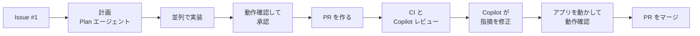

# ハンズオン本編（40 分）: クーポンコード機能を PR で届ける

Bean & Byte Café の注文アプリに「クーポンコード」機能を追加します。
Issue を作り、Copilot と計画・実装・テストを行い、アプリで動作確認してから PR にして CI と Copilot コードレビューを通します。レビューの指摘を Copilot に修正させたあとでもう一度アプリを動かして確認し、マージするまでを体験します。
時間に余裕がある人は、最後に [発展課題](#発展課題15-分) に挑戦します。



## 進め方

- 各ステップの最後に **✅ チェックポイント** があります。確認してから次に進みます。
- Copilot へのプロンプトは、このガイドからコピー＆ペーストします。
- コマンドは VS Code のターミナル（`` Ctrl+` ``）で、リポジトリのフォルダーで実行します。

| ステップ | 内容 |
| --- | --- |
| [1](#1-アプリを動かす03-分) | アプリを動かす |
| [2](#2-issue-を作る36-分) | Issue #1 を作る |
| [3](#3-copilot-で計画する610-分) | 並列に進められる作業項目に分けて計画 |
| [4](#4-計画を実装する1025-分) | 子セッションで並列に実装し、動作確認して承認すると PR が作られる |
| [5](#5-pr-を確認する2527-分) | PR の確認、Copilot レビューの依頼 |
| [6](#6-レビューに対応する2733-分) | Copilot に指摘を修正させ、VS Code で PR をチェックアウトしてアプリを動かす |
| [7](#7-pr-をマージする3336-分) | PR をマージする |
| [発展課題](#発展課題15-分) | 任意 |

## 1. アプリを動かす（0〜3 分）

```bash
npm ci
npm run dev
```

ブラウザで http://localhost:3000 を開き、メニューの ＋ で商品を選んで「注文する」を押します。
サーバーのログを見たいので、このターミナルは開いたままにし、以降のコマンドは **新しいターミナル**（ターミナルパネルの ＋）で実行します。

✅ 注文後に「注文番号 ORD-0001」と小計・合計が表示される

## 2. Issue を作る（3〜6 分）

テンプレートから Issue を作ります。

1. 左のアクティビティバーの **GitHub** アイコンを開き、**Issues** の見出しにある **＋**（Create Issue）をクリックします。
2. テンプレートの一覧から **お店から届いたクーポンの要望（ハンズオン課題）** を選びます。
3. Issue の下書きがエディターに開きます。内容はそのままで、エディター右上の **✓**（Create Issue）をクリックします。

✅ `gh issue view 1` で「注文するときにクーポンを使えるようにしてほしい」が表示される（店舗スタッフの言葉で書かれた要望と利用例を読んでおきます）

## 3. Copilot で計画する（6〜10 分）

作業をできるだけ並列に進められる作業項目（独立した子セッション。例: フロントエンド、バックエンドなど）に分けて計画します。

チャット（Plan エージェント）で次のように送ります。`〈…〉` の部分は、「適用」ボタンでクーポンが使えたときに見せたい演出に書き換えます。例から選んでも、自分で考えてもかまいません。

```text
Issue #1 を実装する計画を立ててください。作業は独立した子セッションで並列に実装できるように分けます。「適用」ボタンでクーポンが使えたときの演出は「〈演出。例: 紙吹雪が舞う／値引き額がカウントアップする／コーヒーカップから湯気が立つ〉」にします。
```

✅ 作成された計画書が `docs/plan.md` に保存されている

## 4. 計画を実装する（10〜25 分）

計画が固まったら、新しいチャットセッションを開き、次のように送ります。動作確認のあと「OK」と返すだけで PR まで作られるように、PR 作成の指示も最初に渡しておきます。

```text
/fleet docs/plan.md を読んで実装してください。実装とテストが終わったら、コミットする前にいったん止まり、ブラウザでの動作確認を私に依頼してください。私が「OK」と返したら、変更を coupon ブランチにコミットしてプッシュし、main 向けの PR を作ってください。
```

### 動作確認して承認する

Copilot から動作確認の依頼が来たら、ブラウザで http://localhost:3000 を再読み込みします（ステップ 1 の `npm run dev` が変更に合わせて自動で再起動します。止めていた場合は `npm run dev` で起動し直します）。

メニューの ＋ で 1,000 円以上になるように商品を選び、次の 2 つを試します。

1. **使えないコード**: `HELLO` と入力して「適用」を押す → 値引きされず、使えない理由が表示される
2. **使えるコード**: `WELCOME10` と入力して「適用」を押す → 演出が表示され、10% の値引き額と値引き後の合計が表示される。そのまま「注文する」を押す

問題がなければ、同じチャットで次のように返します。直してほしい点があれば、「OK」の代わりにその内容を送ります。

```text
OK
```

✅ `coupon` → `main` の PR が作られている

## 5. PR を確認する（25〜27 分）

ブラウザで自分のリポジトリ（`https://github.com/<workshop-org>/cafe-order-<user>`）の **Pull requests(PR)** タブを開き、 PRを開きます。

- 右側の **Reviewers** で **Copilot (Balanced)** を既に割り当てられます。

✅ PR で CI（`ci`）とCopilot Code Reivewが実行されている（約 30 秒で成功）

## 6. レビューに対応する（27〜33 分）

Copilot のレビューは **約 2〜3 分** で届きます。

ブラウザで PR の **Conversation** タブまたは **Files changed** タブを開いて確認します。
待っている間に、CI のジョブサマリー（Actions → 実行 → Summary）でカバレッジの表も見てみましょう。

対応したい指摘があれば、そのまま Copilot に任せて修正させます。

✅ 修正のコミットで CI が再実行され、成功します。

### 修正のあとでアプリを動かす

アプリの動作確認は、**Copilot の修正が PR に入ったあと** に、VS Code で PR をチェックアウトして行います。

1. 左のアクティビティバーの **GitHub** アイコンを開き、**Pull Requests** の一覧から自分の PR をクリックします。
2. PR の詳細画面で **Checkout** をクリックします。Copilot の修正コミットも含めて、PR のブランチが手元に取り込まれます。
3. ステップ 1 で起動した `npm run dev` が変更に合わせて自動で再起動するので、ブラウザで http://localhost:3000 を再読み込みします（止めていた場合は `npm run dev` で起動し直します）。

✅ 画面でクーポンコードを入力して「適用」でき、注文できる

## 7. PR をマージする（33〜36 分）

1. PR の下部にあるマージボックスで、CI が成功していることを確認します。
2. マージボタンの ▼ から **Squash and merge** を選び、ボタンを押して確定します。
3. PR が **Merged** になったことを確認します。

## 発展課題（+15 分）

### スタック PR で届ける

本編で作った 1 つの PR を、`gh stack` で n 層のスタック PR として出し直します。層の数と分け方は、Copilot が立てる計画で決まります。
大きな変更を、レビューしやすい小さな PR に分ける体験です。

```text
(main) ← 1 層目 ← 2 層目 ← … ← n 層目
```

- `gh stack` は必ずこのガイドのとおり、引数やフラグを付けて実行します（引数なしの `gh stack view` や `gh stack submit` は対話画面が開きます）。
- 各 PR の説明では、「変更点」にどのレイヤーかを書き、そのレイヤーの変更だけが含まれていることを確認します。

### 準備

`gh stack` 拡張機能が入っているか確認します。

```bash
npm run precheck -- --stretch
```

`gh stack` で NG が出たら、インストールしてからもう一度確認します。

```bash
gh extension install github/gh-stack
```

### A. スタックに分ける

チャットで次のように送ります。

```text
Issue #1 を実装する計画を立ててください。gh-stack スキルを使って、n 層のスタック PR にします。レイヤーはそれぞれ独立した子セッションで並列に実装できるように分けます。「適用」ボタンでクーポンが使えたときの演出は「〈演出。例: 紙吹雪が舞う／値引き額がカウントアップする／コーヒーカップから湯気が立つ〉」にしてください。
```

PR が作られたら、PR #2 は **Close pull request** で閉じます（マージしません）。

✅ ブラウザで一番下の PR（→ `main`）を開くと、スタックのマップに n 個の PR が下の層から順に並び、すべて CI（`ci`）が成功している

### B. レビューに対応する

スタックの各 PR を開き、**Reviewers** で **Copilot (Balanced)** を既に割り当てられます。

PR に指摘が届いたら、Copilotで対応させます。

✅ すべての PR で CI が再実行され、成功している

### C. スタックをマージする

ブラウザで一番上の PR を開きます。スタックの PR のマージボックスには、スタック全体の状態が表示されます。一番上の PR をマージすると、その下の PR もまとめてマージされます（すべての PR で CI が成功している必要があります）。

1. 一番上の PR の下部にあるマージボックスで、すべての PR の CI が成功していることを確認します。
2. **Rebase stack** ボタンが表示されていたら、クリックしてスタックを積み直し、CI の再実行が終わるのを待ちます。
3. マージボタンの ▼ から **Squash and merge** を選び、ボタンを押して確定します。
4. すべての PR が **Merged** になったことを確認します。
