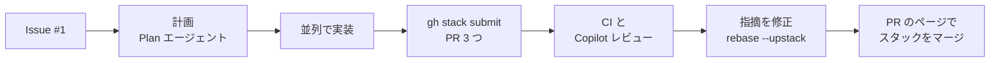

# ハンズオン本編（40 分）: クーポンコード機能をスタック PR で届ける

Bean & Byte Café の注文アプリに「クーポンコード」機能を追加します。
Issue を作り、Copilot と計画・実装・テストを行い、3 つのスタック PR にして CI と Copilot コードレビューを通し、マージするまでを体験します。



```text
(main) ← coupon/core ← coupon/api ← coupon/ui
         ① ドメイン・計算  ② API          ③ 画面
```

## 進め方

- 各ステップの最後に **✅ チェックポイント** があります。確認してから次に進みます。
- Copilot へのプロンプトは、このガイドからコピー＆ペーストします。
- コマンドは VS Code のターミナル（`` Ctrl+` ``）で、リポジトリのフォルダーで実行します。
- `gh stack` は必ずこのガイドのとおり、引数やフラグを付けて実行します（引数なしの `gh stack view` や `gh stack submit` は対話画面が開きます）。

| ステップ | 内容 |
| --- | --- |
| [1](#1-アプリを動かす03-分) | アプリを動かす |
| [2](#2-issue-を作る36-分) | Issue #1 を作る |
| [3](#3-copilot-で計画する610-分) | 並列に進められる作業項目に分けて計画 |
| [4](#4-計画を実装する1025-分) | 子セッションで並列に実装し、スタックにまとめて PR を出す |
| [5](#5-pr-を確認する2527-分) | PR の確認、`Closes #1`、Copilot レビューの依頼 |
| [6](#6-レビューに対応する2733-分) | Copilot の指摘を core で修正し、上に積み直す |
| [7](#7-スタックをマージする3336-分) | PR のページから 3 つまとめてマージ |

## 0. はじめる前に

VS Code で自分のリポジトリ（`cafe-order-<user>`）を開き、ターミナルで最新の `main` にいることを確認します。

```bash
git switch main
git pull
npm run precheck
```

## 1. アプリを動かす（0〜3 分）

```bash
npm ci
npm run dev
```

ブラウザで http://localhost:3000 を開き、メニューの ＋ で商品を選んで「注文する」を押します。
サーバーのログを見たいので、このターミナルは開いたままにし、以降のコマンドは **新しいターミナル**（ターミナルパネルの ＋）で実行します。

✅ 注文後に「注文番号 ORD-0001」と小計・合計が表示される

## 2. Issue を作る（3〜6 分）

VS Code の GitHub Pull Requests 拡張機能で、テンプレートから Issue を作ります。

1. 左のアクティビティバーの **GitHub** アイコンを開き、**Issues** の見出しにある **＋**（Create Issue）をクリックします。
2. テンプレートの一覧から **お店から届いたクーポンの要望（ハンズオン課題）** を選びます。
3. Issue の下書きがエディターに開きます。内容はそのままで、エディター右上の **✓**（Create Issue）をクリックします。

✅ `gh issue view 1` で「注文するときにクーポンを使えるようにしてほしい」が表示される（店舗スタッフの言葉で書かれた要望と利用例を読んでおきます）

## 3. Copilot で計画する（6〜10 分）

作業をできるだけ並列に進められる作業項目（独立した子セッション。例: フロントエンド、バックエンドなど）に分けて計画します。

チャット（Plan エージェント）で次のように送ります。`〈…〉` の部分は、「適用」ボタンでクーポンが使えたときに見せたい演出に書き換えます。例から選んでも、自分で考えてもかまいません。

```text
Issue #1 を実装する計画を立ててください。gh-stack スキルを使って、3 層のスタック PR にします。3 つのレイヤーはそれぞれ独立した子セッションで並列に実装できるように分け、上のレイヤーが使う下のレイヤーの型・関数のシグネチャを計画の中で先に決めてください。「適用」ボタンでクーポンが使えたときの演出は「〈演出。例: 紙吹雪が舞う／値引き額がカウントアップする／コーヒーカップから湯気が立つ〉」にして、ui レイヤーの計画に含めてください。まだコードは書かないでください。
```

✅ 作成された計画書が `docs/plan.md` に保存されている

## 4. 計画を実装する（10〜25 分）

計画が固まったら、新しいチャットセッションを開き、次のように送ります。

```text
/fleet docs/plan.md を読んで実装してください。
```

ステップ 1 で起動した `npm run dev` はファイルの変更を監視しているので、変更に合わせて自動で再起動します。ブラウザで http://localhost:3000 を再読み込みし、Issue の利用例どおりに動くか試します。

| 注文内容 | クーポンコード | 期待する結果 |
| --- | --- | --- |
| カフェラテ・カプチーノ・本日のコーヒー（1,450 円） | `welcome10`（小文字で、前後に空白を入れる） | 145 円引きで 1,305 円。演出が表示される |
| 本日のコーヒー（400 円） | `STAMP500` | 0 円（マイナスにならない） |
| カフェラテ・本日のコーヒー（950 円） | `WELCOME10` | 金額不足の理由が表示される |
| 任意 | `HELLO` | 使えないコードの理由が表示される |
| 任意 | なし | 今までどおり注文できる |

✅ 手元のブラウザで、上の 5 つのケースが期待どおりに動く

## 5. PR を確認する（25〜27 分）

ブラウザで自分のリポジトリ（`https://github.com/<workshop-org>/cafe-order-<user>`）の **Pull requests** タブを開きます。

- `coupon/core`、`coupon/api`、`coupon/ui` の 3 つの PR が並んでいることを確認します。
- 一番下の PR（`coupon/core` → `main`）を開き、スタックのマップに 3 つの PR が `main` ← core ← api ← ui の順に並んでいることを確認します。

✅ ブラウザで PR #2 を開くと、スタックのマップに 3 つの PR が並び、3 つとも CI（`ci`）が実行されている（約 30 秒で成功）

## 6. レビューに対応する（27〜33 分）

Copilot のレビューは PR ごとに **約 2〜3 分** で届きます。

スタックの各 PR（core、api、ui）をブラウザで開き、右側の **Reviewers** で **Copilot (Balanced)** を割り当てます。

ブラウザで PR の **Conversation** タブまたは **Files changed** タブを開いて確認します。
待っている間に、CI のジョブサマリー（Actions → 実行 → Summary）でカバレッジの表も見てみましょう。

## 7. スタックをマージする（33〜36 分）

ブラウザで一番上の PR（#4、ui）を開きます。スタックの PR のマージボックスには、スタック全体の状態が表示されます。一番上の PR をマージすると、その下の PR（#2、#3）もまとめてマージされます（すべての PR で CI が成功している必要があります）。

1. PR #4 の下部にあるマージボックスで、3 つの PR の CI がすべて成功していることを確認します。
2. **Rebase stack** ボタンが表示されていたら、クリックしてスタックを積み直し、CI の再実行が終わるのを待ちます。
3. マージボタンの ▼ から **Squash and merge** を選び、ボタンを押して確定します。
4. PR #2、#3、#4 が **Merged** になったことを確認します。
